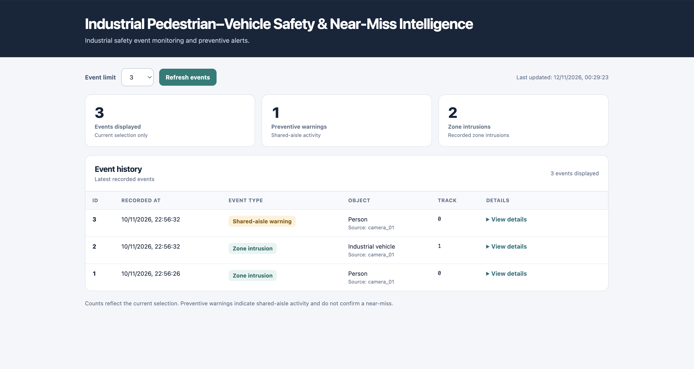

# Industrial Pedestrian–Vehicle Safety & Near-Miss Intelligence

An end-to-end computer vision application for industrial safety monitoring. It detects and tracks pedestrians and industrial vehicles, generates rule-based preventive warnings, and provides persistent event history through a REST API and web dashboard.

## Demo

### Industrial Video Analytics


https://github.com/user-attachments/assets/45ae48cf-d228-4c15-87ac-8ca571f3d28e


<details>
<summary><sub>Original footage by NVIDIA (CC BY 4.0) · Detection, tracking and safety annotations by this project.</sub></summary>

<sub><a href="https://huggingface.co/datasets/nvidia/PhysicalAI-SmartSpaces">Original footage</a> · <a href="https://creativecommons.org/licenses/by/4.0/">License</a></sub>

</details>

### Event Monitoring Dashboard



## Features

- YOLO-based detection of pedestrians and industrial vehicles using ONNX Runtime.
- Multi-object tracking with ByteTrack.
- Configurable zone-intrusion and line-crossing rules.
- Preventive pedestrian–vehicle shared-aisle warnings.
- SQLite event persistence, REST API and web dashboard.
- Docker-based deployment.

## Architecture

```text
Video → Detection → Tracking → Event Engine
                                    ↓
                                 SQLite
                                    ↓
                              REST API → Dashboard
```

**Tech stack:** Python · PyTorch (model training) · OpenCV · YOLO · ONNX Runtime · ByteTrack · SQLite · HTML/CSS/JavaScript · pytest · Docker

## Verified Results

| Metric | Result |
|---|---|
| Industrial video frames processed | 120 |
| Zone-intrusion events | 2 |
| Preventive shared-aisle warnings | 1 |
| Persisted events | 3 |
| End-to-end processing speed | 15.08 FPS |
| Automated tests | 23 passed |

Results are from the documented industrial demonstration. Processing speed was measured locally on macOS (Apple Silicon), not as an inference-only benchmark. Integrated execution was also verified in a Linux ARM64 Docker container.

## Getting Started

From the repository root, using a Python virtual environment:

```bash
python -m pip install -r requirements.txt
```

Provide a compatible ONNX model and input video separately. Set the model, video and database paths in `config/mvp_industrial_video_02.yaml`, and adapt the event-rule geometry to the camera view.

Run the core analytics pipeline:

```bash
PYTHONPATH=src python -m video_analytics --config config/mvp_industrial_video_02.yaml
```

Start the API with the database generated by the pipeline (adjust the path if the configuration was changed):

```bash
PYTHONPATH=src python -m video_analytics.api_server --database data/events.db --port 8000
```

Open the [dashboard](http://127.0.0.1:8000/dashboard) or query [recorded events](http://127.0.0.1:8000/events).

The original footage and trained model are not bundled. The annotated demonstration and reported warning results were produced using a dedicated integration workflow; the core pipeline command above is not a reproduction of that demonstration.

## Current Scope

The project demonstrates preventive shared-aisle warnings and zone-intrusion detection on recorded industrial video. Validated near-miss detection, collision prediction and production-scale deployment are outside the current scope. This is an engineering prototype, not a certified industrial safety system.
